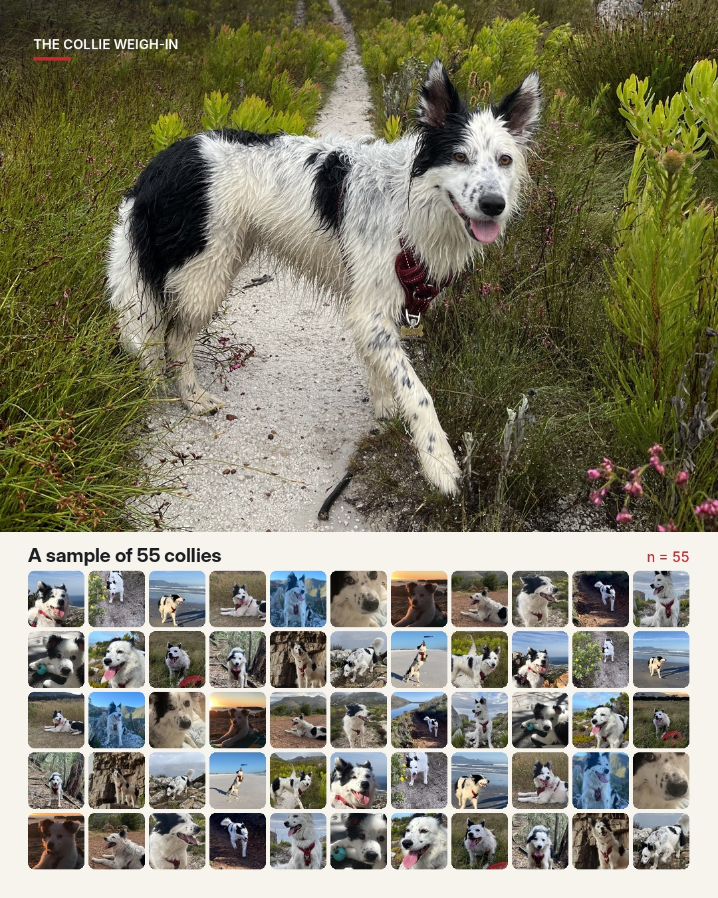

# How to make an average of a sample represent the population with Bootstrapping

Nov 23, 2026 · Jolene Wium

*"**Repetition is the mother of learning"** - my squash coach from 2004.*

How much does the average Border Collie in South Africa weigh?

I could weigh Sky, my Border Collie, and ask another 54 owners to weigh theirs. How confident could I be that the average of those 55 dogs represents every Border Collie in the country?

In statistics, we usually work with a sample that stands in for a broader population. Sometimes you can measure every member of the population, such as the grades of every child in a particular class. Often, though, that's simply not practical. Take a question close to my heart (that's Sky above): how much does the average border collie in South Africa weigh? There's no way to put every collie in the country on a scale. So say I send a survey to the Border Collie Club of South Africa and 55 owners reply with their dog's weight. Those 55 dogs are my sample, and their average weight is my best guess for all border collies.

The catch is that a sample is never a perfect copy of the population. If a different 55 owners had replied, I'd get a slightly different average, purely by chance. A sample can also be biased: club members might keep their dogs leaner than the average pet owner, or owners of farm dogs might never see the survey. Either way, the average on its own isn't enough. If my 55 collies average, say, 18 kg, is the true average give or take 0.2 kg, or give or take 3 kg? We need to report how far off it could plausibly be.

I recently did an assignment on a technique that answers exactly this question, called bootstrapping, and I enjoyed the ideas behind it so much that I wanted to share it online. Bootstrapping literally means pulling yourself up from your bootstrings, an impossible task. Its the same as making data sense out of nothing.

## The idea behind bootstapping

The trick goes like this: you only have one sample. Draw a new "fake" sample from your original sample it *with replacement* (so some dogs get picked twice and some not at all), calculate your statistic, and repeat that thousands of times. The spread of all those recalculated answers tells you how much your original answer could have wobbled just by the luck of who ended up in your sample.

Nothing special. Just your sample data and a lot of repetition.

Back to the collies. Picture writing each of the 55 weights on a slip of paper and putting them in a hat. Draw a slip, note the weight, put the slip back, and repeat until you have 55 weights. Some dogs will turn up twice or three times, and some won't turn up at all. Work out the average of this new "survey". Then do it again, 5,000 times (R does this in under a second). Each round is a slightly different set of replies the club could plausibly have sent. The middle 95% of those 5,000 averages gives a confidence interval for the average weight of South African border collies, and nobody had to weigh another dog.

## Why we need bootstrapping and why do we need to know the variability

The most honest way to find out how much my collie average wobbles would be to repeat the survey: find another 55 border collies, weigh them, calculate the average again, and do that a few hundred times. The spread of all those averages is exactly the variability needed to know if the first sample represents the population.

Bootstrapping swaps "repeat the survey" for "resample the replies you already have". You get thousands of plausible re-runs of your one study sample. These simulated reruns gives a standard error, or any interval you like (the 2.5th to 97.5th percentiles for a 95% interval, the 10th to 90th for an 80% one), for almost any statistic. It lets you answer "how sure are we?" for the statistic you obeserve, given a simple sample.

## A real example: quitting smoking and weight gain

For a recent class in biostatistics, I used the [bootstrapping library in R](https://www.stat.cmu.edu/~larry/=sml/Boot.pdf) on data from the [US National Health and Nutrition Examination Survey Epidemiologic Follow-up Study (NHEFS)](https://miguelhernan.org/whatifbook). The study followed 1,629 smokers from 1971 to 1982. After excluding 63 people whose weight change wasn't recorded, 1,566 remained: 403 who quit smoking and 1,163 who continued.

The question was simple: how much more weight did quitters gain, and how confident could we be in that difference?

**Step 1: Comparing medians.** Weight change was unevenly distributed, with some participants gaining considerably more than others. I therefore compared medians rather than means. Quitters gained a median of 3.97 kg, compared with 2.15 kg among those who continued smoking, a difference of approximately 1.8 kg.

How reliable was that difference? I drew 5,000 bootstrap samples, resampling quitters and non-quitters separately, and recalculated the difference each time. The resulting 95% confidence interval was 0.9 to 2.7 kg. Since the interval excluded zero, the difference was statistically significant.

**Step 2: Adjusting for confounders.** Next, I used simple linear regression to account for differences in age, sex, education, smoking habits and starting weight. After adjustment, quitters gained approximately 3.4 kg more on average (95% CI: 2.5–4.3 kg).

I then used bootstrapping to check the uncertainty estimated by the regression model. The bootstrap standard error was 0.477 kg, compared with the conventional estimate of 0.441 kg. The results were broadly consistent, although the bootstrap suggested slightly greater uncertainty.

**Step 3: How many repetitions are enough?** Bootstrapping itself involves randomness, so I wanted to know whether 5,000 resamples were sufficient. I repeated the analysis 20 times, using 200, 1,000, 5,000 and 10,000 resamples. As the number increased, the results became more stable. By 5,000, the variation between runs was small enough for this analysis.

I enjoyed was that the same simple principle worked throughout: repeat the analysis on resampled data and observe how much the answer changes.

## What bootstrapping can't do

It would be unfair to oversell it. Bootstrapping only measures *sampling* uncertainty, the randomness of who happened to be in your data. It can't fix:

- **Biased data.** In my analysis, the 63 people with missing weight were older and many had died during follow-up. Leaving them out tilts the results toward healthier survivors, and no amount of resampling corrects that.
- **Confounding.** The bootstrap told me how precise the 3.4 kg estimate was, not whether quitting *caused* it. Those are adjusted associations, not proof of cause and effect.
- **Tiny or unusual samples.** If your sample doesn't resemble the population, resampling it just multiplies its quirks. It also struggles with very jumpy statistics (like the maximum) and with clustered data unless you resample whole clusters.

In other words, bootstrapping is excellent at answering "how sure can I be, given this data?" It's silent on "is this the right data?" You still have to ask that question yourself.

## The takeaway

Bootstrapping turns a statistics problem that might need pages of maths into something anyone with a laptop can do: reuse the data you have, many times over, and watch how much the answer moves. In my project it confirmed that quitters gained noticeably more weight, double-checked the textbook formulas, and even checked itself.

For everyone else, the lesson travels well. Before you act on a number, whether it's a health reading, fruit weight in a vineyard, ask how much it could plausibly have varied. Sometimes the best way to understand your data is to shake it up a few thousand times and see what falls out.

---

*Data: NHEFS, a publicly available follow-up of the first US National Health and Nutrition Examination Survey. Analysis done in R with 5,000 bootstrap replicates as part of the PPH7090S Seminars in Epidemiology and Biostatistics** at the University of Cape Town.*

*The Border Collie Club survey is an illustrative example, not real data. How cute is Sky though?*
